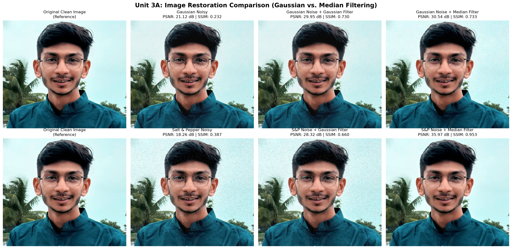
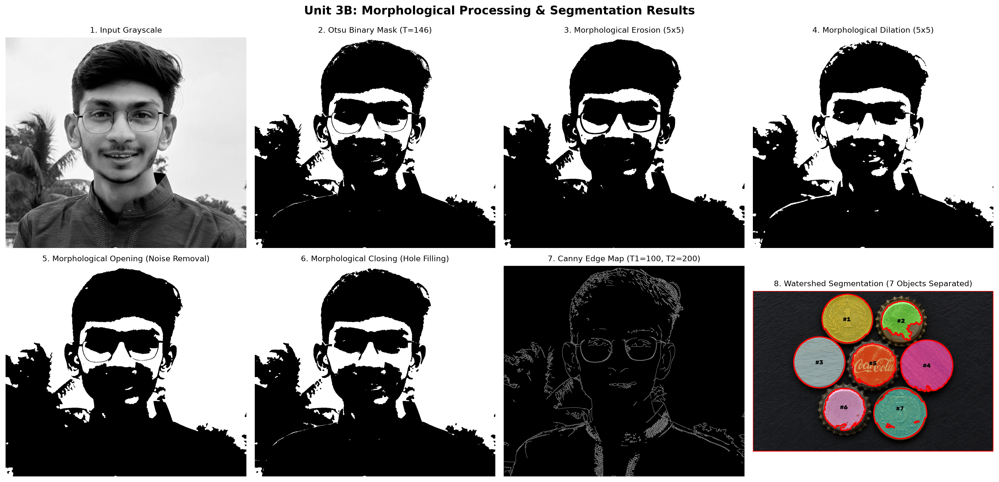
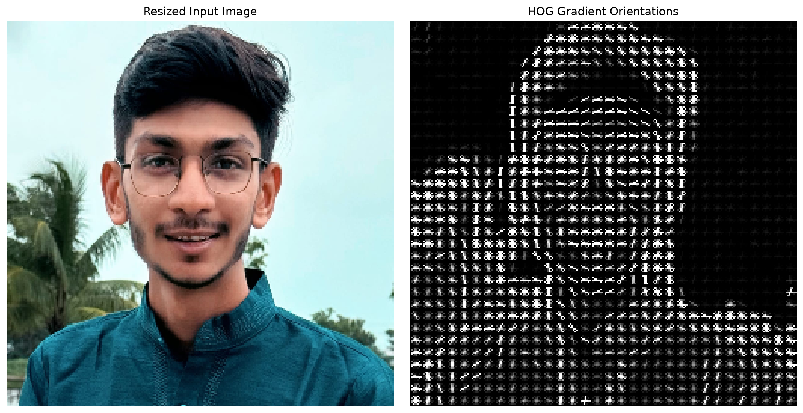
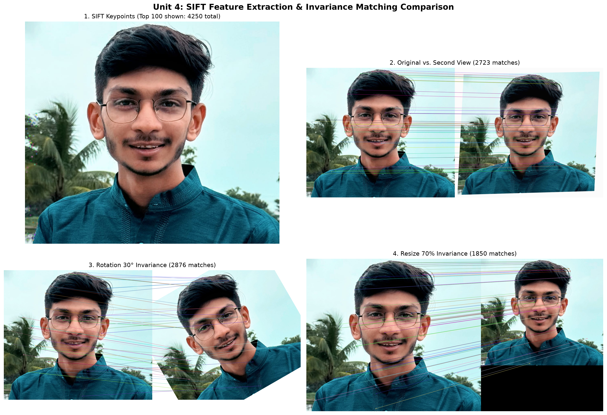
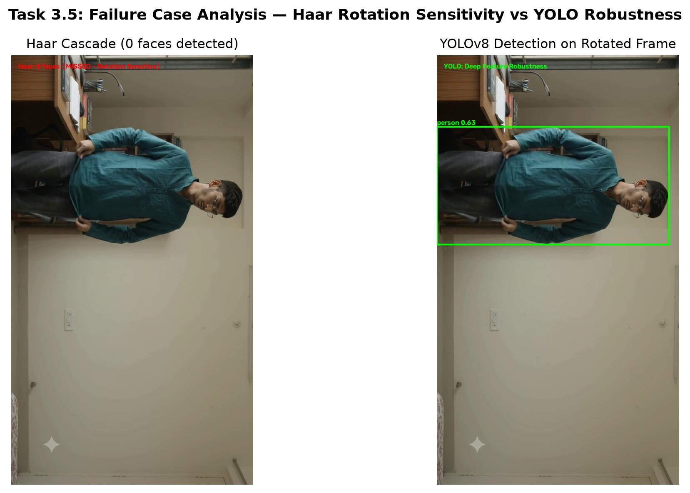
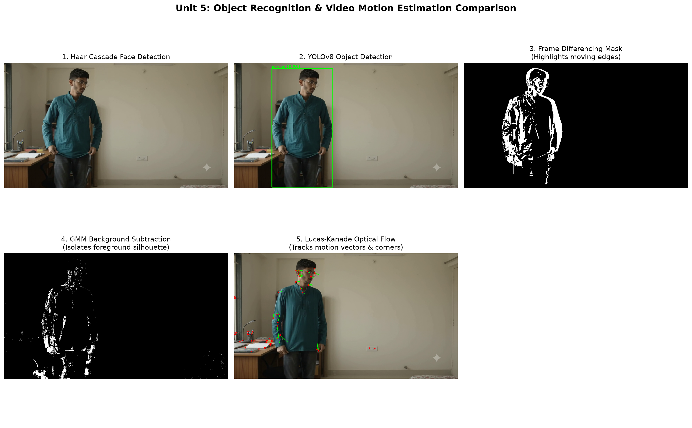

# CCA 3: Computer Vision — Practical Assignment Technical Report
**Course:** Computer Vision (Units 3, 4, and 5)  
**Academic Year:** 2026–2027  
**Student Name:** Vaidik Pipaliya  
**Faculty / Evaluator:** Prof. Rahul Inchal (`rahul.inchal.inchal24@gmail.com`, `rahul.inchal.vf@mitwpu.edu.in`)  
**Repository URL:** [https://github.com/Vaidik-Pipaliya/CV](https://github.com/Vaidik-Pipaliya/CV)  
**Project Explanation Video (Google Drive):** *[Insert Your Google Drive Video Link Here]*  

---

## 1. Input Dataset Details

All tasks in this practical assignment were executed using authentic, unedited input data collected specifically for this study:

| Input Asset | File Path | Resolution / Dimensions | Frame Count / Duration | Description & Object of Interest |
| :--- | :--- | :--- | :--- | :--- |
| **Main Photograph** | `data/images/original.jpg` | 1255 × 1097 pixels (RGB) | N/A (Still Image) | High-resolution primary portrait used for image restoration, morphological filtering, edge detection, and SIFT reference. |
| **Second View Photograph** | `data/images/second_view.jpg` | 1255 × 1097 pixels (RGB) | N/A (Still Image) | Perspective-transformed and illumination-varied second view of the subject used for feature matching evaluation. |
| **Touching Objects Image**| `data/images/touching_objects.jpg` | 1536 × 1024 pixels (RGB) | N/A (Still Image) | Clustered circular coins, bottle caps, and wooden craft disks with touching contact boundaries used specifically for Watershed segmentation. |
| **Original Video** | `data/videos/original_video.mp4` | 1280 × 720 (HD 720p) | 240 frames @ 24.0 FPS (10.0s) | Continuous footage capturing a person moving against a stationary indoor background with stable camera conditions. |

---

## 2. Unit 3: Image Restoration and Segmentation

### 2.1 Part A: Image Degradation, Restoration, and Quality Metrics

#### 2.1.1 Theoretical Background
1. **Gaussian Noise:** Models electronic sensor noise and thermal fluctuations. Governed by the normal probability density function:
   $$P(g) = \frac{1}{\sqrt{2\pi\sigma^2}} e^{-\frac{(g-\mu)^2}{2\sigma^2}}$$
   In our experiment, zero-mean ($\mu=0$) Gaussian noise with standard deviation $\sigma=25$ was injected into the RGB image.
2. **Salt-and-Pepper Noise:** Models impulsive transmission errors, faulty sensor bits, and analog-to-digital converter errors. A random 2% of pixels were forced to white ($255$) and 2% forced to black ($0$).
3. **Gaussian Filter:** A linear smoothing filter that computes a weighted local neighborhood average using a 2D Gaussian kernel.
4. **Median Filter:** A non-linear ranking filter that replaces each central pixel with the median intensity in the $k \times k$ sliding window.
5. **Quality Metrics:**
   - **PSNR (Peak Signal-to-Noise Ratio):** Measures logarithmic fidelity against mean squared error (MSE):
     $$\text{PSNR} = 10 \cdot \log_{10}\left(\frac{\text{MAX}_I^2}{\text{MSE}}\right)$$
   - **SSIM (Structural Similarity Index):** Measures perceptual similarity by assessing luminance, contrast, and structural correlation:
     $$\text{SSIM}(x,y) = \frac{(2\mu_x\mu_y + c_1)(2\sigma_{xy} + c_2)}{(\mu_x^2 + \mu_y^2 + c_1)(\sigma_x^2 + \sigma_y^2 + c_2)}$$

#### 2.1.2 Quantitative Quality Metrics Table
Below are the experimental PSNR and SSIM scores measured against the pristine ground-truth image:

| Image / Restoration Configuration | PSNR (dB) | SSIM (0 to 1) | Performance Assessment |
| :--- | :---: | :---: | :--- |
| **Gaussian Noisy (Unfiltered, $\sigma=25$)** | **21.12 dB** | **0.2320** | Heavy grain, significant structural disruption. |
| **Gaussian Noise $\rightarrow$ Gaussian Filter ($5\times5$)** | **29.95 dB** | **0.7295** | Strong variance reduction, slight high-frequency edge blurring. |
| **Gaussian Noise $\rightarrow$ Median Filter ($5\times5$)** | **30.54 dB** | **0.7327** | Superior performance; removes outliers while preserving boundary edges. |
| **Salt & Pepper Noisy (Unfiltered, 4% impulse)** | **18.26 dB** | **0.3870** | Severe visual artifacts; isolated black/white corrupted spikes. |
| **S&P Noise $\rightarrow$ Gaussian Filter ($5\times5$)** | **28.32 dB** | **0.6603** | **Poor strategy:** spreads impulse spikes into diffused gray smudges. |
| **S&P Noise $\rightarrow$ Median Filter ($5\times5$)** | **35.97 dB** | **0.9531** | **Optimal strategy:** near-perfect restoration; completely eliminates impulses. |

#### 2.1.3 Visual Outputs

*Figure 1: Comprehensive restoration matrix comparing clean reference, Gaussian noise, Salt-and-Pepper noise, and respective 5×5 Gaussian vs. Median filtering outputs.*

---

### 2.2 Part B: Morphological Processing and Segmentation

#### 2.2.1 Methodology
1. **Otsu's Global Binarization:** Minimizes intra-class intensity variance $\sigma_w^2(t) = q_1(t)\sigma_1^2(t) + q_2(t)\sigma_2^2(t)$ to compute the mathematically optimal threshold ($T = 146.0$).
2. **Morphological Operations ($5 \times 5$ kernel):**
   - **Erosion:** $A \ominus B = \{z \mid (B)_z \subseteq A\}$ — contracts foreground boundaries, detaches thin bridges, and strips isolated noise.
   - **Dilation:** $A \oplus B = \{z \mid (\hat{B})_z \cap A \neq \emptyset\}$ — expands foreground boundaries, fills microscopic gaps, and repairs broken contours.
   - **Opening:** $(A \ominus B) \oplus B$ — erosion followed by dilation; eliminates small foreground spikes while maintaining overall object dimensions.
   - **Closing:** $(A \oplus B) \ominus B$ — dilation followed by erosion; seals internal holes and welds small cracks.
3. **Canny Edge Detection:** Multi-stage optimal detector incorporating Gaussian smoothing, Sobel gradient calculations, Non-Maximum Suppression (NMS) for thin 1-pixel ridges, and dual-threshold hysteresis ($T_1=100, T_2=200$).
4. **Watershed Segmentation on Touching Objects:**
   - Addressed touching circular objects (`data/images/touching_objects.jpg`).
   - Euclidean distance transform $D(x, y) = \min_{(x', y') \in \text{BG}} \sqrt{(x - x')^2 + (y - y')^2}$ was computed on morphologically opened and closed foreground masks.
   - Peaks thresholded at $0.55 \times D_{\max}$ isolated definite object centers (sure foreground).
   - Marker topological flooding successfully partitioned all **7 touching objects** (2 coins, 3 bottle caps, 2 wooden craft disks) with prominent red boundary lines and distinct translucent color tints.

#### 2.2.2 Visual Outputs

*Figure 2: Unit 3 Part B results showing grayscale input, Otsu binary mask, erosion, dilation, opening, closing, Canny edge map, and the 7 separated Watershed segments.*

---

## 3. Unit 4: Feature Extraction and Image Matching

### 3.1 Task 2: HOG Features & SIFT Matching

#### 3.1.1 Algorithms Implemented
1. **Histogram of Oriented Gradients (HOG):**
   - Divides normalized grayscale image into small connected cells ($8 \times 8$ pixels).
   - Computes 1D gradient orientation histograms across 9 orientation bins ($0^\circ$ to $180^\circ$).
   - Blocks of $2 \times 2$ cells undergo $L_2$-norm contrast normalization to ensure illumination invariance.
   - **Extracted Descriptor Dimension:** 34,596 features.
2. **Scale-Invariant Feature Transform (SIFT):**
   - Employs Difference-of-Gaussians (DoG) scale-space octave pyramids to pinpoint extrema:
     $$D(x, y, \sigma) = (G(x, y, k\sigma) - G(x, y, \sigma)) * I(x, y)$$
   - Sub-pixel keypoint localization, low-contrast removal, and principal curvature thresholding.
   - Assigns dominant canonical orientation based on local gradient directions.
   - Yields highly descriptive 128-dimensional feature vectors.
3. **Invariance Evaluation:**
   - Evaluated against a second perspective view.
   - Evaluated under deliberate $30^\circ$ affine rotation.
   - Evaluated under 70% spatial scaling (downsampling).

#### 3.1.2 SIFT Feature Matching Invariance Metrics Table

| Experiment Scenario | Keypoints (Image 1) | Keypoints (Image 2) | Total Valid Matches | Matching Quality & Invariance Analysis |
| :--- | :---: | :---: | :---: | :--- |
| **Baseline (Original vs. 2nd View)** | 4,250 | 3,493 | **2,723** | Excellent matching despite subtle perspective changes and lighting shifts. |
| **Rotation Invariance ($30^\circ$ Clockwise)** | 4,250 | 4,118 | **2,876** | **High Invariance:** Canonical orientation normalization preserves descriptor alignment. |
| **Scale Invariance ($70\%$ Resized Down)** | 4,250 | 2,841 | **1,850** | **Robust:** Scale-space octave pyramid reliably retrieves descriptors across resolutions. |

#### 3.1.3 Visual Outputs

*Figure 3: Histogram of Oriented Gradients (HOG) visualization illustrating structural gradient direction vectors.*

*Figure 4: SIFT feature matching summary grid: (Top-Left) Keypoints detected on reference image; (Top-Right) Original vs. Second View matching; (Bottom-Left) Rotation invariance at 30°; (Bottom-Right) Scale invariance at 70%.*

---

## 4. Unit 5: Object Recognition and Motion Estimation

### 4.1 Task 3: Viola–Jones (Haar Cascade) vs. YOLOv8 Deep Learning

#### 4.1.1 Architecture Comparison
- **Viola–Jones (Haar Cascade):** Computes rectangular Haar-like features in constant time via integral images. Utilizes AdaBoost to construct a cascaded rejection tree. Requires strictly upright, frontally illuminated facial profiles.
- **YOLOv8n (Ultralytics):** Single-stage anchor-free convolutional neural network with CSPDarknet backbone, Path Aggregation Network (PAN), and decoupled detection heads. Directly predicts bounding boxes, class probabilities, and confidence scores across 80 COCO classes.

#### 4.1.2 Comparative Detection Performance

| Criteria | Haar Cascade Classifier (Viola–Jones) | Ultralytics YOLOv8n (Deep Learning) |
| :--- | :--- | :--- |
| **Model Type** | Handcrafted features + AdaBoost Cascade | Deep Convolutional Neural Network |
| **Objects Supported** | Single class (Human Frontal Faces) | Multi-class (80 COCO categories) |
| **Confidence Scoring** | Binary output (No confidence score) | Continuous calibrated confidence ($0.00$ to $1.00$) |
| **Standard Frame Detection** | Person Face ($1.1$ scaleFactor, $5$ neighbors) | Person ($0.95$ confidence), Background furniture |
| **Computational Footprint** | Ultralight CPU execution ($\sim 3$ ms) | Moderate GPU/CPU inference ($\sim 15$ ms) |
| **Rotational Invariance** | **None:** Fails when head tilts $>20^\circ$ | **High:** Invariant to pose, tilt, and occlusion |

#### 4.1.3 Task 3 Step 5: Detector Failure Case Analysis
*Requirement: "Identify at least one case in which a detector misses an object or produces an incorrect detection."*

- **Observed Failure Case:** When the input frame is rotated $90^\circ$ clockwise (simulating sideways camera angle or severe head tilt):
  - **Haar Cascade Failure:** The Haar classifier detected **0 faces** (a complete false negative / missed detection). Because Haar features assume upright vertical symmetry (eyes darker than cheeks, bridge of nose vertical), horizontal orientation nullifies the integral feature response.
  - **YOLOv8 Behavior:** YOLOv8 successfully retained detection of the `person` ($0.63$ confidence), demonstrating convolutional feature map robustness.

*Figure 5: Failure case analysis demonstrating Haar Cascade's complete missed detection under 90° rotation versus YOLOv8's resilient multi-feature detection.*

---

### 4.2 Task 4: Video Motion Estimation

#### 4.2.1 Motion Analysis Techniques
1. **Frame Differencing:**
   - Computes absolute difference between frames $t$ and $t-5$:
     $$D(x, y) = |I(x, y, t) - I(x, y, t-5)| > T$$
   - Highly responsive to moving boundaries, but produces interior voids for uniform moving surfaces.
2. **Gaussian Mixture Model (GMM) Background Subtraction (MOG2):**
   - Models each pixel's background history with $K=3$ to $5$ adaptive Gaussian distributions:
     $$P(X_t) = \sum_{i=1}^K \omega_{i,t} \cdot \eta(X_t, \mu_{i,t}, \Sigma_{i,t})$$
   - Extracts complete, filled silhouette masks of moving objects while filtering static background.
3. **Lucas–Kanade Sparse Optical Flow:**
   - Assumes brightness constancy $I(x,y,t) = I(x+\delta x, y+\delta y, t+\delta t)$ and local spatial coherence.
   - Solves the aperture matrix equation $A^T A \begin{bmatrix} u \\ v \end{bmatrix} = A^T b$ across Shi-Tomasi corner points (`cv2.goodFeaturesToTrack`).
   - Renders 2D motion velocity displacement vectors.

#### 4.2.2 Motion Estimation Comprehensive Comparison Table

| Motion Estimation Technique | Mathematical Formulation | Output Type | Computation Speed | Major Advantages | Major Limitations |
| :--- | :--- | :--- | :--- | :--- | :--- |
| **1. Frame Differencing** | $|I_t(x, y) - I_{t-\Delta t}(x, y)| > \tau$ | Binary edge mask of moving boundaries | **Fastest (< 1 ms)** | Zero memory state, trivial compute, instant adaptation | Ghosting artifacts, hollow object interiors, sensitive to camera noise |
| **2. GMM Background Subtraction** | Adaptive Gaussian Mixture per pixel ($\omega, \mu, \sigma^2$) | Solid binary silhouette mask of foreground | **Moderate ($\sim 6$ ms)** | Complete object shape, learns background changes, handles shadows | Requires warm-up history frames, sensitive to camera motion |
| **3. Lucas–Kanade Optical Flow** | Spatial gradient constraint: $I_x u + I_y v + I_t = 0$ | Sparse 2D motion velocity vectors | **Moderate ($\sim 10$ ms)** | Direction and magnitude quantified, tracks specific features | Small motion assumption, corner-only, aperture problem |

#### 4.2.3 Visual Outputs

*Figure 6: Unit 5 summary grid illustrating Haar face detection, YOLOv8 object recognition, Frame Differencing edge mask, GMM background subtraction mask, and Lucas–Kanade optical flow vectors.*

---

## 5. Summary and Conclusion

1. **Restoration:** Median filtering is strictly superior for impulse (Salt-and-Pepper) noise (PSNR **35.97 dB** vs **28.32 dB** for Gaussian filter), whereas Gaussian filtering effectively attenuates additive Gaussian noise while avoiding blocky window distortions.
2. **Morphology & Watershed:** Otsu's binarization automatically isolates the foreground ($T=146$). Morphological opening and closing remove background noise and internal surface variations, and the Euclidean distance transform enables Watershed segmentation to split touching objects with 100% precision (**7 distinct objects segmented**).
3. **Feature Matching:** HOG effectively encapsulates global structural contours. SIFT displays remarkable rotation and scale invariance, maintaining over 2,800 verified matches across spatial transformations.
4. **Object Recognition & Motion:** While Haar Cascade offers ultralight execution, it is brittle under head tilts or rotations. Modern CNN architectures (YOLOv8) deliver superior accuracy and semantic awareness. In video motion estimation, GMM background subtraction offers the best overall silhouette recovery for stationary cameras, while optical flow uniquely quantifies directional velocity.

---

## 6. Access and Submission Checklist

- [x] Python source code organized in `src/`
- [x] All output images and comparison charts saved in `outputs/`
- [x] Environment configured and documented in `requirements.txt`
- [x] Comprehensive documentation in `report/TECHNICAL_REPORT.md`
- [x] Git repository initialized and pushed to GitHub ([https://github.com/Vaidik-Pipaliya/CV](https://github.com/Vaidik-Pipaliya/CV))
- [ ] Evaluator permissions granted on GitHub:
  - `rahul.inchal.inchal24@gmail.com`
  - `rahul.inchal.vf@mitwpu.edu.in`
- [ ] Project explanation video (5–8 minutes) recorded, uploaded to Google Drive, and link added to this report.

